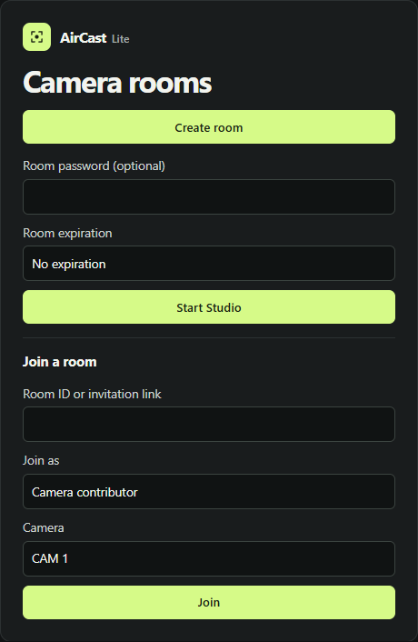
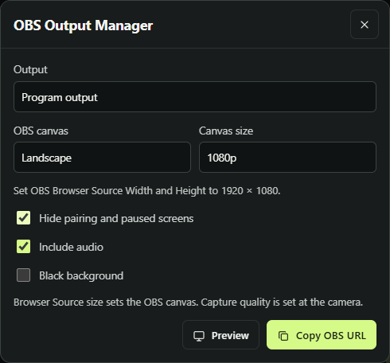
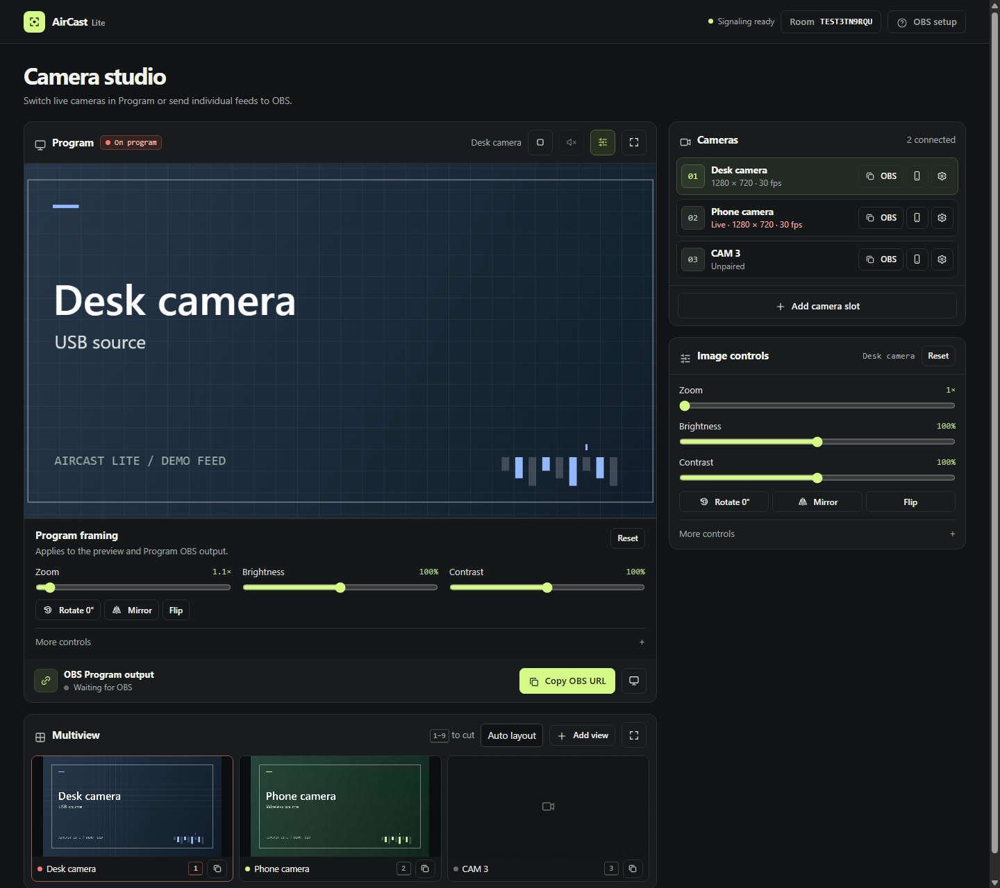
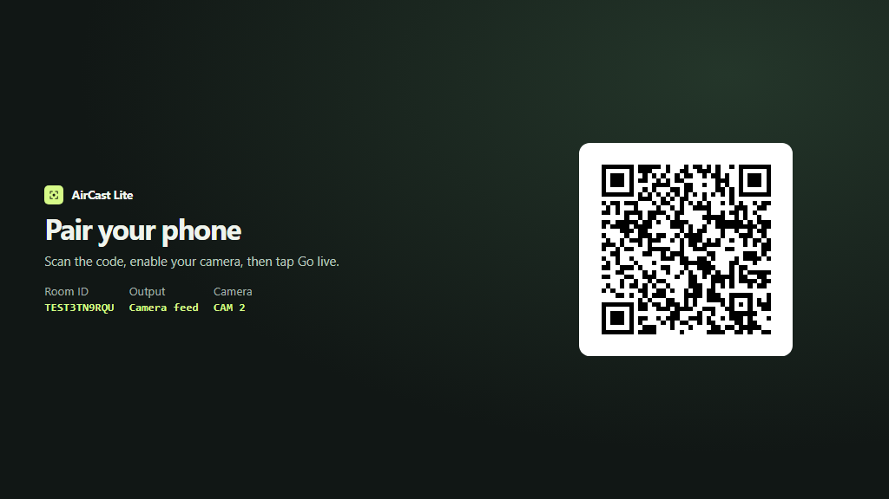
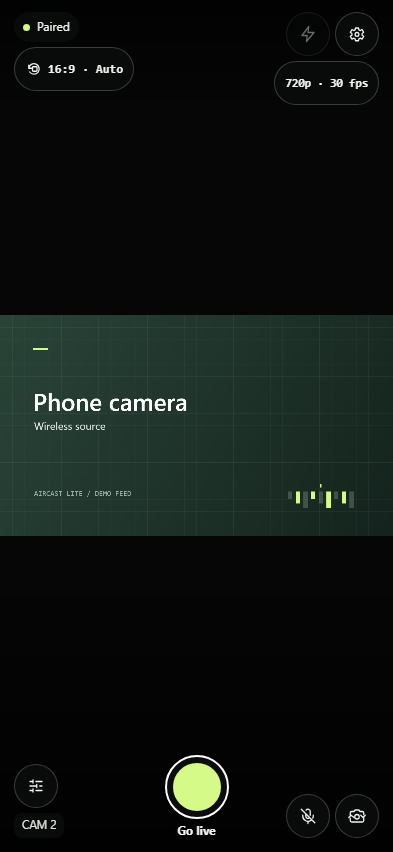
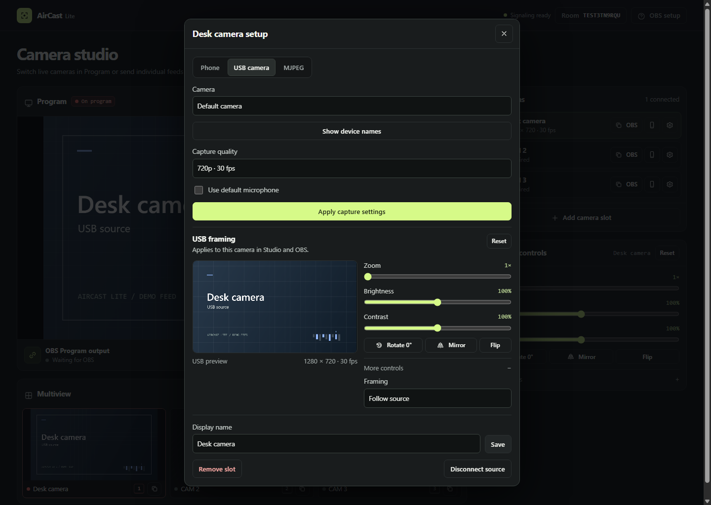

# AirCast Lite

Turn a phone, USB webcam, or MJPEG camera into an OBS Browser Source. Use a camera URL for one feed, or use the Program URL to switch live feeds from Studio with short dissolves.

[Deploy with Cloudflare Pages](docs/cloudflare-pages.md)

## Rooms and OBS outputs

Select **Create room** on the home page. Choose a password and an expiration if you need them, then select **Start Studio** to generate the Room ID. To join an existing room, enter its ID or pairing link and choose **Camera contributor** or **Program viewer**. Contributors pick a slot before joining. Each room keeps separate Studio settings.



Add the **Program** URL to OBS once. Select **Multiview** in Studio’s Program controls to show the same camera grid in Studio’s Program monitor and the OBS source. Select **Back to Program** to return both to the selected camera. Multiview carries audio from the selected Program camera. Use **Add view** to configure up to 24 slots.

Open **Outputs** for Browser Source dimensions, individual camera links, and clean-feed, mute, and background settings. Press **D** in an interactive output or choose **Connection diagnostics** in Camera settings for connection status and video statistics.



A password of at least 12 characters encrypts the room in the browser. Share the full OBS or camera link or its QR code, then give the password to participants separately. A QR opens the assigned slot directly in an open room. Protected rooms ask for the password. When using a protected Browser Source in OBS, open **Interact** to enter it. Reopening the source or refreshing its browser page requires unlocking again.

Encrypted links work on static HTTPS hosting. The optional Cloudflare R2 setup enables shorter links, joining encrypted rooms by Room ID, and server-side expiry of future downloads. AirCast also closes expired room connections in its clients. [Cloudflare storage and expiry](docs/cloudflare-pages.md#optional-encrypted-room-storage)



Screenshots show the running AirCast app with demonstration camera feeds.

## Choose an OBS workflow

| Use | Link | Keep open |
| --- | --- | --- |
| Switch cameras from AirCast | Studio → **Copy OBS URL** beneath Program | Studio and the cameras in use |
| Send one phone camera directly | Phone → **Camera settings** → **Copy OBS URL** | The phone camera page |
| Send one USB or MJPEG camera | Studio → Cameras → **OBS** beside that camera | Studio |

### Add the link in OBS

1. Add a **Browser** source and paste the copied URL. Use the deployed HTTPS address for a phone on another device.
2. Set the Browser Source and OBS canvas to the same dimensions. Use **1920 × 1080** for landscape or **1080 × 1920** for portrait.
3. For phone video, scan the pairing QR shown in OBS. On the phone, enable the camera and tap **Go live**. For a USB or MJPEG feed, connect the camera in Studio.
4. To keep the source connected while switching OBS scenes, leave **Shutdown source when not visible** and **Refresh browser source when scene becomes active** off. For phone audio, enable the microphone on the phone and select **Control audio via OBS** in the Browser Source. [OBS Browser Source settings](https://obsproject.com/kb/Browser-Source)



### Pair and operate a phone

1. Scan a camera’s QR to open its assigned slot, or join from the home page by entering the **Room ID** and choosing **Camera contributor** and the slot. Enter the room password if prompted.
2. Tap **Enable camera**, then **Go live**. Use the capture chip to change stream resolution and frame rate. Available resolutions run from 360p to 4K, depending on the camera and browser. **Adapt quality to network** lets the browser balance stream quality and smoothness. **Use 360p for low bandwidth** selects the lowest stream preset.
3. Tap the bottom-left sliders icon for zoom, brightness, and contrast. The rotate button turns the OBS feed by 90° and locks the angle. Re-enable **Auto-rotate video for OBS** in Camera settings to follow device orientation.
4. Use **Hide camera from the output** while live to pause video and microphone audio while you keep the local preview and pairing. Tap it again to resume. **Disconnect** releases the slot and brings back the pairing screen. Leaving the phone camera page also releases the camera.



### Connect and frame a USB camera

1. In Studio, open a camera slot’s gear menu and choose **USB camera**. Pick the device and capture quality, then select **Connect camera**. Allow camera access when the browser prompts. Choose **Show device names** if the device list is anonymous.
2. Use the live **USB framing** preview to set rotation, horizontal mirror, vertical flip, zoom, brightness, contrast, and framing. **Fit entire frame** preserves the edges. **Fill frame** crops the edges needed to fill the canvas.
3. The corrections belong to the camera slot and carry through to its Multiview tile, individual OBS link, and Program whenever that camera is live. Close setup to return to Studio. Use **Apply capture settings** to change the connected device or capture quality.



### Switch and frame Program

- Click a live Multiview tile or press **1–9** to put that camera on Program. The previous feed stays visible until the new feed has a frame ready.
- Open the sliders button in the **Program** header for output-wide rotation, zoom, mirror, flip, brightness, contrast, or framing. These controls apply on top of the camera’s corrections and stay in place as you switch sources. Individual camera URLs keep their own framing.
- Use **Reset** in the relevant panel to reset either a camera slot or the Program framing. Framing is saved in the current browser.
- **Add view** creates a camera slot. Use the Multiview layout menu to choose the number of columns. Each tile’s copy button gives you the same individual OBS URL as its Cameras row.

### Connect an MJPEG camera

Open a camera slot’s gear menu, choose **MJPEG**, and enter the camera’s JPEG stream endpoint. For an HTTPS Studio page, use an HTTPS stream that your browser can access. Use Studio’s **Image controls** panel to adjust its framing.

## Local development

The app is static and ships with its PeerJS dependency. From the repository root, serve `public/` over localhost with any static server. For example, with Python 3 installed:

```sh
python -m http.server 8000 --directory public
```

Open `http://localhost:8000/`. For phone pairing across devices and for the installable PWA, use the deployed HTTPS address. Cloudflare Pages serves the app shell. PeerJS handles signaling and WebRTC carries the camera feed.

See [Contributing](CONTRIBUTING.md) for automated tests, [Architecture](docs/architecture.md) for source layout, and [Security](SECURITY.md) for room access and reporting. AirCast Lite is distributed under the [MIT License](LICENSE).
