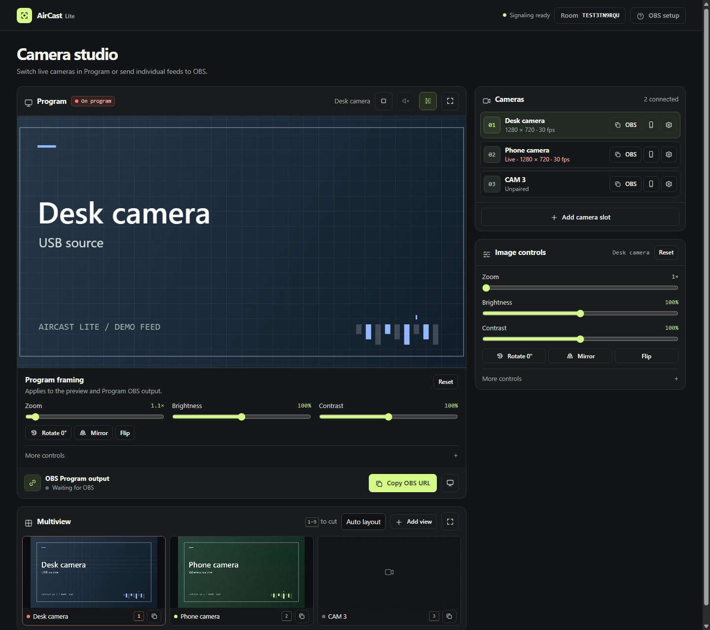
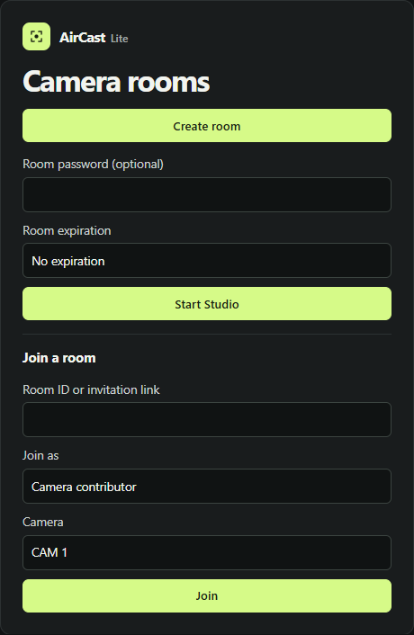

# Deploy AirCast Lite with Cloudflare Pages

This repo keeps the deployable app in [`public/`](../public/) and the illustrated usage guide in the [README](../README.md). Cloudflare Pages can publish the static files directly from GitHub.

## Connect the GitHub repository

1. Sign in to Cloudflare. In **Workers & Pages**, choose **Create application**, then **Pages**, then **Connect to Git** or **Import an existing Git repository**.
2. Authorize Cloudflare’s GitHub integration for `kyawzin19997/aircast-lite`, select that repository, and begin setup.
3. Use these build settings, then select **Save and Deploy**.

| Setting | Value |
| --- | --- |
| Production branch | `main` |
| Framework preset | `None` |
| Build command | `exit 0` |
| Build output directory | `public` |
| Root directory | Leave at the repository root |
| Environment variables | Leave empty for standard deployment |

Cloudflare’s documentation shows the current [Git integration flow](https://developers.cloudflare.com/pages/get-started/git-integration/) and the recommended [static HTML build settings](https://developers.cloudflare.com/pages/framework-guides/deploy-anything/).

## Test your deployment

1. Open the HTTPS `*.pages.dev` address shown by Pages. Use that same address on the computer, in OBS, and on the phone.
2. In AirCast, copy the Program URL or an individual camera URL. Paste it into an OBS Browser Source. Scan the pairing QR and tap **Go live** on the phone.
3. If you connect a custom domain, copy fresh links from the app at that domain. In the Pages project, use **Custom domains** and follow the prompts. [Cloudflare Pages custom domains](https://developers.cloudflare.com/pages/configuration/custom-domains/)



## Publish updates

Push changes to `main`. Cloudflare Pages builds the new production deployment automatically. Refresh the Studio, phone page, and OBS Browser Source after a deployment. Keep the service worker and the other assets together in `public/`.

If you are working locally from a clone:

```sh
git clone https://github.com/kyawzin19997/aircast-lite.git
cd aircast-lite
```

After editing the app, run the local smoke test described in the [README](../README.md#local-development), commit the changed files, and push `main`.

## Enable passwords and expiration

The public workflow runs without bindings. Passwords and room expiration use the room authority. Deploy it from the cloned repository root:

```sh
npx wrangler@4.166.0 deploy --config infra/wrangler.toml
```

In the Pages project settings, add a **Durable Object namespace** binding named `ROOMS` for the `RoomAuthority` class in the `aircast-room-authority` Worker. Add it to each production or preview environment that should allow private rooms, then redeploy Pages. Only `/api/rooms` invokes the Pages Function. [Cloudflare Durable Objects](https://developers.cloudflare.com/durable-objects/get-started/) · [Pages bindings](https://developers.cloudflare.com/pages/functions/bindings/)

From AirCast home, choose **Create room**, then optionally set a password and an expiration before selecting **Start Studio**. Expiration defaults to **Never**. Once a room expires, camera and Program connections end and room entry closes. Keep the Studio tab open while the Program output is in use.



### Configure an optional TURN relay

To use Cloudflare Realtime TURN with private rooms, create a TURN key and add its ID and API token as Pages secrets named `TURN_KEY_ID` and `TURN_KEY_API_TOKEN`. Redeploy after setting them. AirCast exchanges authenticated room sessions for expiring ICE credentials. The API token stays on the server. [Cloudflare TURN credential generation](https://developers.cloudflare.com/realtime/turn/generate-credentials/)

For another TURN provider or a public-room deployment, configure a same-origin endpoint through `aircast-ice-endpoint` that returns the documented `iceServers` JSON response. Restrict access to the endpoint and keep long-lived provider credentials on the server. Test from a different network and check that diagnostics reports **Relayed** when a relay is needed.

## Troubleshooting

| Symptom | Check |
| --- | --- |
| Pages reports 404 | Verify the output directory is `public` and the deployed folder includes `index.html`. |
| The repo is missing from the Cloudflare picker | Check that Cloudflare’s GitHub app has permission for this repo. [GitHub integration settings](https://developers.cloudflare.com/pages/configuration/git-integration/github-integration/) |
| OBS shows a QR but the phone does not connect | Open both devices on the deployed HTTPS site, confirm the room and camera slot, and try the same Wi-Fi network. Keep Studio open for Program, USB, and MJPEG. Individual phone camera links can connect with Studio closed. |
| Camera or microphone permission is blocked | Grant the site permission in the browser and reopen Camera settings. Local testing can use `localhost`. |
| Restricted networks block video | An optional same-origin TURN credential endpoint can be configured with the `aircast-ice-endpoint` meta tag. It must return an `iceServers` array with short-lived, authorized credentials. Keep provider credentials on the server. |
| An older interface keeps appearing | Confirm the new commit is the production deployment, then use OBS Browser Source’s cache refresh and reopen AirCast on the phone. |
